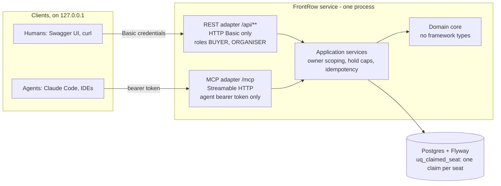

# FrontRow

> **Status:** Phase 1 is the whole project (spec revision 2.7): the domain core, the REST API with Swagger UI, the five
> MCP tools, the evidence artifacts and the local `docker compose` run are built. It is a finished, local-only portfolio
> project ([ADR-006](docs/adr/ADR-006-portfolio-scope.md)), not a service to put on a public URL.

An event ticketing and seat-reservation service in Spring Boot, exposed through
two inbound adapters over one domain core: a REST API for humans, and an MCP
server for agents.

Two things it is built to demonstrate:

1. **Correctness under concurrency** — double-booking is prevented by a
   Postgres partial unique index rather than by application logic, and that is
   proven by a test where N threads race for the same seat and exactly one
   wins. Run against real Postgres via Testcontainers.
2. **Agent-facing API design** — thin, single-responsibility MCP tools with
   typed schemas, structured error contracts, and a stated threat model. The
   central decision: **an agent can hold seats; only a human can buy them.**
   There is no `confirm_order` tool.

## Architecture and threat model

The domain core has no Spring Web types and no MCP types. Both adapters are HTTP, in one process, each behind its own
security filter chain, and both call the same application services. MCP is just another inbound adapter: the domain
does not know it exists. MCP is served over Streamable HTTP only
([ADR-003](docs/adr/ADR-003-streamable-http-only-transport.md)).



### Trust boundaries

- **Two disjoint credential chains** ([ADR-002](docs/adr/ADR-002-agents-hold-humans-buy.md)). `/api/**` accepts HTTP
  Basic only, and a bearer token sent there is refused. `/mcp` accepts an agent bearer token only; Basic credentials
  cannot reach it. A third, last chain denies every path except four anonymous ones. All of it lives in
  `security/SecurityConfig.java`.
- **Where each credential is checked.** Basic passwords are checked against in-memory users, stored as bcrypt hashes.
  Agent tokens are checked by their SHA-256 hash against configuration; each token maps to a user, and no MCP tool takes
  an owner or buyer parameter, so identity comes only from the token.
- **What an agent token can reach.** The five MCP tools: search and read events and availability, hold seats (with
  per-owner caps and a required idempotency key) and release a hold. It cannot authenticate against `/api/**`, so it
  cannot reach the confirm endpoint, event creation or the event `PATCH`.
- **What an agent token cannot reach.** Anything that buys. Reads never show another owner's `hold_group_id`, owner or
  `expires_at`.

### Why there is no `confirm_order`

There is deliberately **no `confirm_order` tool**. Holds are reversible and expire on their own; purchases are neither.
Confirmation exists only as `POST /api/holds/{holdGroupId}/confirm`, which accepts HTTP Basic only. Even a fully
compromised or prompt-injected agent can at worst keep seats from other buyers and tamper with its own human's holds (see
below); it cannot buy. A test fails the build if any tool's
name or description reads like a purchase.

The agent holds seats as user X and tells X the `hold_group_id` and expiry. X logs in, sees the hold under
`GET /api/me/holds`, and confirms it.

### What the two approved design decisions cost

Both are approved design decisions (spec §9), not findings.

1. **An agent shares its human's owner.** So an agent can release that human's holds, fill their hold-group cap so the
   human can hold nothing, and replay their idempotency keys. It still cannot buy.
2. **Confirm is tied only to the hold id.** So a prompt-injected agent can steer which hold the human confirms: the
   human confirms whatever that hold contains.

The caps bound how many seats an agent holds at a time (3 groups of up to 8 seats by default), not for how long: its
token never expires and nothing rate-limits `/mcp`, so it can release and hold again in a loop for as long as it runs.

### Organiser blast radius

Organisers are not scoped to their own events (approved limitation 2 below), so one compromised `ORGANISER` account can
cancel every event with nothing sold, releasing its holds; move the sales window of any event not already cancelled, to
close sales, open them early, or reopen or extend them; and put any `DRAFT` event on sale. It cannot cancel an event with
a confirmed order, so no order is lost.

### Demo-grade security, in plain words

The security is **demo-grade**: it exists to show that authorization boundaries were considered and wired, not to be
production authentication. Basic users are in memory, agent tokens are static and never expire, there is plain HTTP on
loopback, and there is no OAuth2. Passwords and tokens are stored only as hashes, and none is committed:
`scripts/demo-credentials.sh` generates them and prints the raw values once. Do not put this on a public URL.

### "Local only" assumptions

Local only is a property of how the demo is run, and it rests on two assumptions:

- **Docker Engine 28.3.3 or later on Linux** for the loopback-only port binding. Earlier engines let a host on the same
  network reach published container ports directly, and engines before 28.3.3 do so again after a firewalld reload
  (CVE-2025-54388). Compose publishes the app on `127.0.0.1` only and does not publish Postgres at all.
- **DNS rebinding.** There is no `Host` check, so a page the local user visits could reach the loopback port through DNS
  rebinding (approved limitation 4 below).

## Run it locally

FrontRow runs only on your own machine, and both ways of running it are reachable only from `127.0.0.1`. Demo-grade security
on a public URL would overstate the security story (spec §2, §3). The host needs JDK 25 even for compose, because
`scripts/demo-credentials.sh` runs on the host.

1. Generate the demo secrets. The passwords and the agent token are printed once; only their hashes are stored. If a
   `config/application-demo.yml` from before plan 4B exists, delete it first:

   ```bash
   bash scripts/demo-credentials.sh
   ```

2. Start the app and Postgres, with seeded venues and events:

   ```bash
   docker compose up --build
   ```

   This needs Docker Engine 28.3.3 or later on Linux, so that the loopback-only port binding holds.

3. Open Swagger UI at <http://127.0.0.1:8080/swagger-ui/index.html>. Choose **Authorize** and sign in as `alice` or
   `bob` (buyers) or `olivia` (organiser), with the password the script printed.

Without a container, against your own Postgres given through `SPRING_DATASOURCE_URL`, `SPRING_DATASOURCE_USERNAME`
and `SPRING_DATASOURCE_PASSWORD`:

```bash
./mvnw spring-boot:run -Dspring-boot.run.profiles=demo -Dspring-boot.run.arguments=--server.address=127.0.0.1
```

A bare `--server.address` on the `mvnw` line goes to Maven, not to the app.

The agent's bearer token is the one the script printed. To use the tools from Claude Code, register `/mcp` with it as an
`Authorization` header; the demo runbook ([`docs/demo/README.md`](docs/demo/README.md)) walks through the buyer and agent
story and how to keep the token off screen.

## Headline metrics

Measured, none estimated. Re-derive them with `./mvnw verify` and then `bash scripts/readme-metrics.sh`, which reads the
surefire reports and the test constants.

| Metric | Value |
|---|---|
| Hold-race test | 8 racers × 20 repetitions; exactly 1 winner per seat per run, and every loser gets `seat_taken` (`HoldConcurrencyTest`) |
| Tests per layer | unit 130, service/integration 145, schema 32, REST 31, MCP 82; 420 in all, 1 skipped (see below) |
| Integration suite runtime | 82 to 95 s over five runs (92 s in the last), summed over the database-backed test classes (Postgres in Testcontainers); a full `./mvnw verify` takes about 2 minutes |
| Tools with checked-in schemas | 5, in [`docs/mcp/tools/`](docs/mcp/tools/) |

A test is "unit" if it starts no Spring context and no Postgres. The skipped test is `EvidenceHygieneTest`'s exact-value
check, which runs only when the real agent token and a password are in the environment.

## Evidence

- Tool schemas, checked in, and CI fails on drift:
  [`check_availability`](docs/mcp/tools/check_availability.schema.json),
  [`get_event`](docs/mcp/tools/get_event.schema.json),
  [`hold_seats`](docs/mcp/tools/hold_seats.schema.json),
  [`release_hold`](docs/mcp/tools/release_hold.schema.json),
  [`search_events`](docs/mcp/tools/search_events.schema.json).
- A real failure-and-recovery run: [`logs/example_run.txt`](logs/example_run.txt). An agent loses a seat to a second
  buyer, gets `seat_taken`, re-checks availability and holds different seats. The conflicting hold was scripted; the
  conflict, the error and the recovery are unedited. It shows no credential.
- The demo storyboard and recording runbook: [`docs/demo/README.md`](docs/demo/README.md). The recording itself is
  added to `docs/demo/` by hand and has not been made yet.
- Decisions: [`docs/adr/`](docs/adr/). Design spec:
  [`docs/superpowers/specs/2026-09-17-frontrow-design.md`](docs/superpowers/specs/2026-09-17-frontrow-design.md).

## Known limitations

### Approved security limitations

These four are approved by Markus (spec §9). A new security finding is fixed, or brought to him to approve onto this
list; it is not added here on its own.

1. **Login timing can reveal a username, but only for a hand-written bcrypt hash at a cost other than 10.** Reason:
   `scripts/demo-credentials.sh` always writes cost 10, so this needs an operator to hand-edit config, and it reaches
   only local demo data.
2. **No per-event organiser ownership: any `ORGANISER` may `PATCH` any event.** Reason: the schema records no event
   owner, organisers are trusted staff in a single-box-office demo, and the blast radius is limited to local demo
   events. The organiser blast radius above says what one compromised account can do.
3. **The §3 Fetch Metadata gap, for a run that ignores the documented loopback-only commands, or a browser without Fetch
   Metadata support.** Reason: with the port published on loopback only, no other host's browser can reach the app. The
   remaining cases need someone to expose the port on purpose, or a browser on the same machine without Fetch Metadata
   support (such as Safari before 16.4). Either way they also need a browser that already holds cached credentials.
4. **No `Host` check, lockout or rate limit.** A page the local user visits could reach the loopback port through DNS
   rebinding, and guess passwords online. Reason: only hand-written weak passwords are exposed, since
   `scripts/demo-credentials.sh` generates 192-bit ones, and only local demo data is at risk.

### Hardening left undone

Each of these matches every documented claim but could be stronger. None is part of the core guarantee (no
double-booking, no purchase over MCP, the disjoint chains, the role table, owner scoping), none shows in the demo story,
and none is an obvious flaw to someone reading the code, so by the spec's quality bar (§9 (c)) each is listed with its
reason instead of being fixed.

- **Fractional JSON numbers on REST are truncated to integers.** A body such as `"event_seat_ids": [1.9]` is read as
  `[1]`, and an organiser's price `1999.9` as `1999`, because Jackson's default is to accept a float for an integer
  field. The MCP tools are stricter: they reject a fraction, and a numeric string, as `invalid_request`. Not fixed: the
  truncated value goes through the same checks as any other id or price, so no invariant or owner rule is bypassed; only
  a mistyped client sees a surprising value.
- **`GET /api/me/orders` is an N+1 and unpaginated.** `OwnerReadService.orders` reads one query for the orders and one
  more per order for its lines. Not fixed: the demo has a handful of orders per buyer, and the endpoint is owner-scoped.
- **Container image tags float.** `Dockerfile` uses `eclipse-temurin:25-jdk` and `eclipse-temurin:25-jre`, and
  `compose.yaml` uses `postgres:18-alpine`, so a rebuild can pull a newer image. Not fixed: the demo is local and
  rebuilt on demand, and digest pins would need upkeep that a finished project does not get.
- **`SeedDataTest` is not hermetic.** It boots the `demo` profile, which also reads a `config/application-demo.yml` if
  your checkout has one, so a stale generated file can break it; CI has no such file. Not fixed: it guards the seed
  (`sales_close_at <= starts_at`), and the workaround is to delete the stale file.
- **`ComposeFileTest` has gaps.** It checks the ports, `network_mode` and the Postgres password source in
  `compose.yaml`, but not an override file, the `Dockerfile`'s `EXPOSE`, or the engine version. Not fixed: the loopback
  binding is guarded by what it does cover, and the engine version cannot be tested from the repository.
- **Availability costs three queries.** `EventReadService.availability` looks up the event, the claimed seat ids and
  the event's seats separately. Not fixed: the venues in the demo have a few dozen seats, and the answer is correct.
- **The run path needs JDK 25 on the host, even for compose,** because `scripts/demo-credentials.sh` runs on the host
  (it compiles the credential generator with the Maven wrapper). Not fixed: it is a one-time setup step, and the
  README states the requirement up front.
- **`scripts/demo-credentials.sh` leaves `config/` with the caller's umask.** The generated file is made readable
  (`chmod 644`), but the directory keeps whatever the caller's umask gave it, so with a umask such as `077` the
  container's non-root user cannot enter the directory, and the read-only bind mount fails on Linux. Not fixed: the
  default umask works.
- **The OpenAPI document marks anonymous reads as needing Basic.** The document declares one Basic requirement for
  everything, while the three event reads need no credentials. Not fixed: the only effect is Swagger UI offering
  Authorize on calls that do not need it, and the REST table in the spec is the authority.
- **Wrongly shaped params on `/mcp` can answer a bare 500.** This covers other JSON-RPC methods with malformed or absent
  params (`completion/complete`, `prompts/get`, `resources/read`, `logging/setLevel`), and `tools/call` whose `arguments`
  is an array or a string or whose `name` is an array. Each gets a 500 Problem Details and logs
  "Unhandled failure in a REST request". There is no hang and no `stack_trace`, and only an authenticated caller can
  send one. Not fixed: the request-shape filter handles the common mis-shaped call (unknown method, non-object
  `params`), and validating every field of every method would duplicate the SDK; the only effect is an unhelpful error
  for a hand-written client.
- **The `/mcp` request-shape filter covers only part of the input.** It applies to `POST`s with a JSON content type and
  to messages whose `id` is a string or a number. A non-JSON content type, an `id` that is `null` or an object, or a
  batch array reaches the MCP SDK unchanged. Not fixed: each needs an authenticated caller sending a message no real MCP
  client produces, and the filter's job is the common mis-shaped call, not a complete JSON-RPC validator.

## Possible next steps

Not commitments; listed so the gaps read as deliberate. These were Phases 2–4 until revision 2.7.

- a hosted demo on Railway, after real authentication (OAuth2 / OIDC), with self-service token issuance;
- observability: Micrometer + Prometheus + Grafana, metrics and tracing over MCP tool calls, a measured tool success
  rate over 10 test prompts, p95 latency;
- event-driven: a transactional outbox + Kafka for `hold_expired` and `order_confirmed` events;
- a thin UI;
- per-event organiser ownership; best-adjacent-seat allocation;
- recurring performances: one event with several dates;
- order cancellation and refunds.

## Where things are

| | |
|---|---|
| Design spec | [`docs/superpowers/specs/2026-09-17-frontrow-design.md`](docs/superpowers/specs/2026-09-17-frontrow-design.md) |
| Decisions | [`docs/adr/`](docs/adr/) |
| Implementation plans | [`docs/superpowers/plans/`](docs/superpowers/plans/) |
| Demo runbook | [`docs/demo/README.md`](docs/demo/README.md) |
