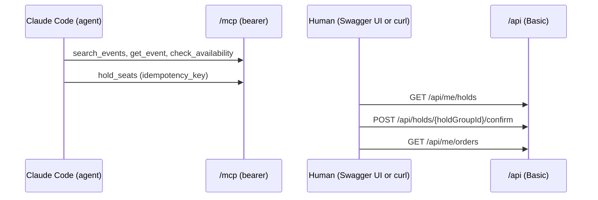

# Demo recording: storyboard and runbook

The recording is a human task (plan 5, Task 8). This file lets the recorder work without improvising. The recording
goes in this directory (a GIF or short video, small enough for the repository) and is linked from the top-level README.
No credential may be visible in it (spec §7).



## Storyboard

1. **Agent finds and holds.** In Claude Code, ask it to find an on-sale event, check seat availability and hold two
   seats. It uses `search_events` (`query`, `from_date`, `to_date`, `limit`), `get_event` (`event_id`),
   `check_availability` (`event_id`, optional `section`) and `hold_seats` (`event_id`, `event_seat_ids`,
   `idempotency_key`). `release_hold` (`hold_group_id`) is the fifth tool; use it for the optional moment below.
2. **Human sees the hold.** `GET /api/me/holds` as the buyer the agent token maps to (`alice`).
3. **Human confirms.** `POST /api/holds/{holdGroupId}/confirm`. No MCP tool can buy; agents hold, humans buy.
4. **Human sees the order.** `GET /api/me/orders`.
5. *Optional, two buyers cannot share a seat.* As `bob`, try `POST /api/events/{eventId}/holds` (header
   `Idempotency-Key`, body `event_seat_ids`) on a seat the agent holds: the answer is `seat_taken`. Or let the agent
   call `release_hold` and show the seat free again.
6. *Optional, organiser arc.* As `olivia`: `POST /api/events` creates a `DRAFT` event, then
   `PATCH /api/events/{id}` puts it `ON_SALE`.

## Before recording (the token never appears on screen)

Do all of this off camera.

1. Generate credentials and start the app: `bash scripts/demo-credentials.sh`, then `docker compose up --build`
   (README "Run it locally"). The script prints the passwords and the agent token once.
2. Put the agent token in an environment variable of the shell you will use, from your password manager or by pasting the
   script output at the prompt with echo off. Never type a value on a line that is shown, never `echo` it:

   ```bash
   read -rs FRONTROW_AGENT_TOKEN && export FRONTROW_AGENT_TOKEN
   ```

3. Register the MCP server. This is the one bounded exception that allows `--header` with the token, and it is
   expanded by the shell from the variable, never typed literally. `--scope local` is pinned because project scope
   would write the raw header into `.mcp.json`, which is not gitignored.

   ```bash
   claude mcp add --scope local --transport http frontrow http://127.0.0.1:8080/mcp \
     --header "Authorization: Bearer $FRONTROW_AGENT_TOKEN"
   ```

   Local scope still stores the expanded value in your user-level Claude config, so that config must not be shown
   either. Check with `claude mcp list` (it lists the server without printing the header).
4. For the human steps use Swagger UI with the Authorize dialog filled **before** recording (then close the
   dialog, and keep the page scrolled away from it), or a `curl` call that takes the password from the variable
   (a password-prompting `curl -u alice ...`, which asks for it silently) in a terminal tab that is not on camera. Better: keep the
   authorised Swagger UI as the only on-screen REST client.
5. Clear the terminal (`clear`), close the shell history view, and start the recording from a clean screen.

### Must not appear on screen

- the output of `scripts/demo-credentials.sh` (passwords, the agent token)
- the `claude mcp add --header` line, `claude mcp list` detail output, `.claude.json`, `.mcp.json`, shell history
- Swagger UI's Authorize dialog while filled, or any `Authorization` header (Basic or Bearer) value
- a `curl -u` line with a literal password; `.env`; `config/application-demo.yml`
- environment dumps (`env`, `printenv`, `set`), and any tool call result that echoes request headers

## Recording

Run the storyboard top to bottom. Keep to one take of about two minutes; trim dead time. Before the take, call each
of the five tools once from Claude Code so that none fails live (see the check below).

## After recording

1. Regenerate the credentials, since the recorded run's secrets existed in your shell and on your machine:

   ```bash
   docker compose down -v
   rm config/application-demo.yml .env
   bash scripts/demo-credentials.sh
   ```

   Then `unset FRONTROW_AGENT_TOKEN`, and remove the old server entry with
   `claude mcp remove frontrow --scope local` (re-add with the new token if you need it again).
2. Scrub the file: step through the whole recording frame by frame (not at speed) and look for any credential, the
   `mcp add` line, or a dialog showing a header.
3. Only then add it to `docs/demo/`, link it from the top-level README, and commit it.
4. In the PR, state that you called each of the five tools from Claude Code and that no credential is visible in
   the recording.

## The check for spec §12

The §12 box reads "All 5 MCP tools callable from Claude Code over Streamable HTTP with a bearer token" (the check runs as follows). During the recording or just
before it, call each of `search_events`, `get_event`, `check_availability`, `hold_seats` and `release_hold` from Claude
Code against the running app, and say in the PR that you did. This Task is BLOCKED until that is done.
