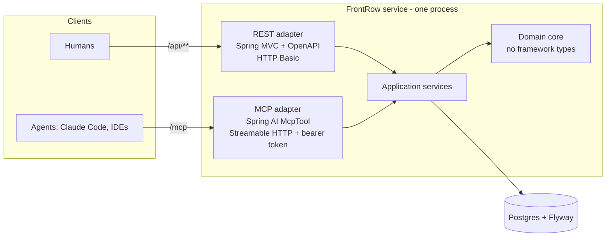
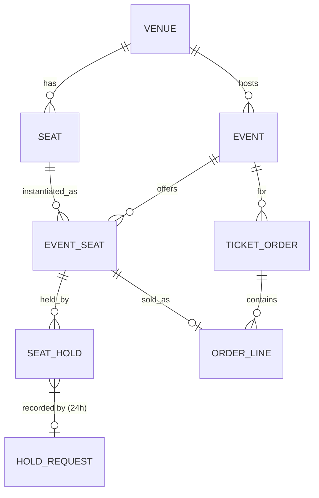

# FrontRow — Design Spec

**Date:** 2026-09-17 · **Revised:** 2026-10-27 (revision 2.7 — see §14)
**Scope (revision 2.7):** FrontRow is a finished, local-only portfolio project. It is judged by reading the repo and README and watching a recorded demo, not by real use. Phase 1 is the whole project; the former Phases 2–4 are possible next steps, not commitments (§9). Work from here meets the portfolio quality bar (§9).
**Status:** Reviewed by the user 2026-09-18. **Implementation in progress:** Phase 1 is seven plans, and plans 1, 2, 3A, 3B and 4A are merged.
- Plan 1 (PR #5) built the build, CI, the V1 schema and the MCP spike.
- Plan 2 (PR #10) built the domain core, the error contract, the JPA persistence model and the locking gateway (ADR-005).
- Plan 3A (PR #18) built hold creation with idempotent replay, and §5 concurrency tests 1, 3, 4, 5 and 7.
- Plan 3B (PR #24) built confirmation, release, the event `PATCH` and cancellation, and the sweeper with the 24-hour key purge, each as a service, and §5 concurrency tests 2 and 6. It also brought hold creation in line with revision 2.6.3's two decisions.
- Plan 4A (PR #29) built the security edge: the three security chains (§3), hashed demo credentials (§9), Problem Details errors and the request bounds (§6), and the transaction guard (§5). It also built four REST write endpoints: hold, release, confirm and the event `PATCH`.

Not yet built: the event-creation service, the read services and the five `GET` endpoints, and springdoc / Swagger UI (plan 4B, which also removes what revision 2.7 cut: the `/api/orders/*` rule, the `ADMIN` role and the `adam` user in `DemoCredentials.java` and `TestCredentials.java`, see §6; and publishes the app's port on loopback only, leaves Postgres's port unpublished, takes compose's Postgres password from a gitignored `.env`, and puts the loopback run command in the README and `CLAUDE.md`, see §3 *The stated gap*; and, on creation and on a `PATCH` that sets a window bound, rejects a sales window that closes after `starts_at`, see §5 *Event cancellation* and §6 *The threat model, in one line*); the MCP tools and evidence artifacts (plan 5); seed data, a datasource configuration and the `docker compose` setup. The `/mcp` chain authenticates agent tokens but serves no tool of its own yet. No datasource configuration, compose file or seed data is committed, so a standalone run needs an external Postgres supplied through the `SPRING_DATASOURCE_*` environment variables (`CLAUDE.md`); with no seed data and no event creation, the golden path has run only in the test suite.

**Tier:** Standard overall. The security slices — REST authorization, MCP
caller authentication, and the agent-to-human hold handover (§6) — are
**Mandatory** tier, since they are auth work behind a published tool contract.
**Revisions 2.1–2.6.1** (same day) apply the review rounds; **2.6.2** (2026-10-05) is a post-implementation sync; **2.6.3** (2026-10-16) syncs the status and settles two questions from plan 3A's reviews; **2.6.4** (2026-10-19) is a post-implementation sync after plan 3B; **2.6.5** (2026-10-22) is a post-implementation sync after plan 4A; **2.7** (2026-10-27) narrows the scope to a portfolio project — see §14.

---

## 1. Why this project exists

FrontRow is a portfolio project with two specific, evidence-backed goals.

**Goal 1 — back an unbacked resume claim.** `Java` is listed under Backend
skills on the resume with no supporting project or work bullet. Infor was LPL
(Infor's proprietary language), RBC is SDET work in Playwright/Postman/
OpenShift, the SAIT capstone was Next.js, and Carpool was Laravel/PHP. Every
other listed skill has a bullet under it; Java is the one load-bearing claim
with nothing attached. This project converts it into a demonstrated skill.

**Goal 2 — demonstrate MCP server design, not just MCP usage.** Existing
portfolio work (The Fourth Official) covers the AI *consumer* side: retrieval,
evals, grounded generation. FrontRow covers the *provider* side: designing an
agent-facing API, tool boundaries, and guardrails on write operations.

These are one project rather than two because the architecture genuinely unites
them (see §3). The portfolio currently contains four JavaScript/TypeScript
projects and zero compiled-language backend services, so this fills a real gap
rather than adding a fifth variation of the same signal.

### Research basis

Design decisions below trace to published 2026 hiring signals:

- Implementation quality outranks idea originality; production hygiene (auth,
  real tests, containerization, DB migrations, concrete README metrics) is what
  gets evaluated.
- **Testcontainers** is repeatedly named as *the* differentiator separating
  strong from weak Spring developers — meaningful integration tests against a
  real database rather than mocking everything.
- **Observability** is absent from roughly 70% of Java resumes (Micrometer,
  Prometheus, Grafana, tracing) — a cheap differentiator, now a possible next
  step rather than a commitment (§9).
- A credible MCP portfolio has a specific published bar: typed JSON schemas
  checked into the repo, **at least one logged tool failure**, thin
  single-responsibility tools, structured error contracts, an architecture
  diagram with a threat model, and measured tool success rate / p95 latency.
  Weak signals are happy-path-only demos, "mega-tools" hiding business logic,
  unstructured output, and MCP on a resume with no server repo.

The MCP bar is, in substance, a testing-and-observability checklist. That plays
directly to SDET experience while reading as current AI work.

---

## 2. Goals and non-goals

### Goals

1. A working Spring Boot service with a defensible domain model and real
   business invariants.
2. Double-booking made **structurally impossible**, proven by a concurrency
   test against real Postgres.
3. An MCP server exposing the same domain, meeting most of the published
   credibility bar (§1): typed schemas checked in, a logged failure case, thin
   tools, structured errors, and an architecture diagram with a threat model.
   The measured tool success rate and p95 latency are a possible next step (§9).
4. Something complete and presentable as a portfolio piece: judged by reading
   the repo and README and watching a recorded demo (§7), not by real use.
   *(Until revision 2.7 this read "within roughly one focused week"; Phase 1 has
   taken over five weeks, see ADR-006.)*

### Non-goals

- **No frontend.** OpenAPI/Swagger UI plus seeded demo data plus the MCP server
  is the demo. Four existing portfolio projects already prove frontend ability;
  this one is deliberately backend-only so effort concentrates on the gap.
- **No real payments.** Order confirmation is simulated. Handling real payment
  credentials is out of scope and would add compliance surface for no portfolio
  gain.
- **No order cancellation or refunds.** A confirmed order is final. This is a
  consequence of §5, not an omission: the sold-once guarantee is a permanent
  constraint, and cancellation would require relaxing it deliberately. The
  future change is stated in §5 so it is a documented extension, not a trap.
- **No recurring performances.** One event = one datetime at one venue. A
  multi-performance model is a documented future enhancement, not a hidden gap.
- **No venue or seat-map management.** Venues and their seats are seed data.
  Organisers create events on existing venues; they do not draw seat maps.
- **No public deployment.** Demo-grade credentials (§9) on a public URL would
  overstate the security story. FrontRow runs locally via `docker compose`; a
  hosted demo would need real authentication first and is a possible next
  step (§9).
- **No Kafka, observability stack, or OAuth2.** All three are in demand, and all
  three are possible next steps (§9), not commitments. Adding them would turn a
  small complete thing into a half-finished everything, which the research says
  is strictly worse.
- **No hardening past the portfolio quality bar (§9).** Accepted demo-grade
  trade-offs are listed in the README's "Known limitations", not fixed.

---

## 3. Architecture

A domain core with two inbound adapters. The core has no Spring Web types and
no MCP types in it; both adapters are thin translation layers over the same
application services. **Both adapters are HTTP, in one process** (§10 explains
why stdio was dropped), each behind its own security filter chain.



**The load-bearing sentence:** MCP is just another inbound adapter — the domain
does not know it exists. A Java reviewer reads ports-and-adapters discipline; an
AI-platform reviewer reads a correct understanding of MCP as an interface layer
rather than a magic AI feature.

**Practical consequence for review:** if a change to an MCP tool requires
changing anything under the domain core, the boundary has leaked. That is a
concrete, checkable review criterion, not an aspiration.

### Caller identity

Every write is attributed to an **owner** — a named user. There is one identity
model with two credential types:

| Adapter | Credential | Resolves to |
|---|---|---|
| REST `/api/**` | HTTP Basic (username + password) | the user |
| MCP `/mcp` | Bearer token issued to a user's agent | the same user |

The two filter chains are disjoint: `/api/**` rejects bearer tokens, `/mcp`
accepts no Basic credentials. Spring's Basic filter silently ignores a `Bearer`
header, so it doesn't do this rejection on its own. `/api/**` has an explicit
filter that returns 401 for any request carrying `Authorization: Bearer` in any
of its `Authorization` headers, on anonymous endpoints too. The `/mcp` chain
installs no Basic filter, so a Basic header authenticates nothing there.
`/mcp` reads only the first `Authorization` header, so a Basic header after a
valid bearer is ignored rather than refused: the request is served as the agent,
with only `AGENT`, and with the Basic header first it gets 401. Plan 5 must check
every header, as `/api/**` does (PR #29 thread 4342413070). That separation is what makes the threat model in §6
enforceable rather than aspirational — an agent token cannot reach the purchase
endpoint at all. No tool parameter carries identity; the owner always comes from
the authenticated principal.

**The owner is the Basic username, for both credentials.** An agent token's
principal name is the username of the user it was issued to, so a user and
their own agent share one owner, one hold-group cap and one idempotency-key
namespace. The handover in §6 depends on this. Every username must match
`^[a-z0-9][a-z0-9._-]{0,63}$`, checked at startup, so no two principals can
alias: there are no case or Unicode look-alikes and no U+0000.

An MCP token carries **no role of its own**. Tokens are issued only to users
who hold `BUYER` (startup fails otherwise), and the MCP chain grants the token a single `AGENT` authority
that is scoped to `/mcp`. An organiser's powers are never reachable through an
agent token.

Everything outside the two chains is closed by default, except for four
anonymous paths: Swagger UI (`/swagger-ui/**`, `/v3/api-docs/**`), `/error`,
and `/actuator/health`. No other actuator endpoint is exposed in Phase 1.

**The chains** (`security/SecurityConfig`), tried in this order:

| Order | Matcher | Takes | Notes |
|---|---|---|---|
| 1 | `/api/**` | HTTP Basic | The bearer-reject filter and the cross-site filter (below) run before Basic authentication. The whole §6 REST role table; any unlisted `/api/**` path is denied |
| 2 | `/mcp`, `/mcp/**` | Agent bearer token | A known token's user, with `AGENT` only |
| 3 | none, evaluated last | — | The four anonymous paths above; everything else denied (ADR-002). Without it, a path matching neither chain would be served with no security at all |

Every chain is stateless, with no session, no request cache and no logout
endpoint, and Spring's CSRF token is off on all three. Every 401 and 403 is a
Problem Details body (§6). The configured users replace Spring Boot's generated
user, which would otherwise authenticate on `/api/**` as a fallback.

**Cross-site requests.** With no session and no cookie, the CSRF risk is Basic
credentials a browser has cached. A hostile page could then make the browser send
an unsafe request, and confirm needs no body: a cross-site form `POST`, a
`fetch` with `mode: 'no-cors'` or a `navigator.sendBeacon` would carry the cached
credentials. Three layers stand against it:
- **no 401 carries a `WWW-Authenticate: Basic` challenge,** so a browser never
  prompts for the credentials and never caches them. RFC 9110 expects a challenge
  on a 401; omitting it is the trade. Swagger UI and `curl` send the header
  explicitly;
- **Fetch Metadata:** on `/api/**`, an unsafe method (anything but `GET`, `HEAD`,
  `OPTIONS` and `TRACE`) whose `Sec-Fetch-Site` is `cross-site` or `same-site`,
  in any case, gets 403. This catches the bodyless request. `same-origin`, `none`
  and an absent header pass, because non-browser clients send none;
- **form types:** on `/api/**`, an unsafe method with a content type a cross-site
  form can send without a CORS preflight (`application/x-www-form-urlencoded`,
  `multipart/form-data`, `text/plain`), or an unparseable one, gets 415. No CORS
  is configured, so a preflight fails.

**The stated gap:** a browser that sends no Fetch Metadata relies on the first
layer alone against a request with no form type, such as a bodyless `no-cors`
`fetch` or a `sendBeacon`. Browsers send Fetch Metadata only to potentially
trustworthy origins (HTTPS, or `localhost`), so this includes any browser
reaching the app over plain HTTP on another host. If such a browser has cached
the credentials by some other route, that request gets through. FrontRow is
local only (§2), and plan 4B publishes the port on loopback only, one measure
per way of running it:

- **`docker compose`:** the compose file publishes the app's port on host
  loopback only (`127.0.0.1:<port>:<port>`). The app inside the container
  listens on all interfaces, as normal, so the published port still reaches it.
  Postgres's port is not published: the app reaches it on the compose network.
  If a host port is ever needed, it is published on `127.0.0.1` only.
  Compose's Postgres password is never committed: it comes from a gitignored
  `.env`, written by `scripts/demo-credentials.sh` or by hand from a committed
  `.env.example` with no real value.
- **The non-container run:** the command is
  `./mvnw spring-boot:run -Dspring-boot.run.profiles=demo -Dspring-boot.run.arguments=--server.address=127.0.0.1`.
  A bare `--server.address` on the `mvnw` line goes to Maven, not the app. Plan
  4B puts this command in the README and in `CLAUDE.md`'s Conventions, which
  until then carries the command that exists today.

The demo profile does not set `server.address`: its file is gitignored and
written by `scripts/demo-credentials.sh`.

**Until plan 4B, the app listens on every interface.** That contradicts the
local-only claim (§2), so it is a defect on `main` (§9 (a)) that plan 4B fixes,
not a known limitation. On a shared network the gap above applies until then,
unless a host firewall blocks the port. After plan 4B, the gap remains only for
a run that ignores the documented commands, or a browser without Fetch Metadata
support: approved known limitation 3 (§9).

**Scaffold spike — answered.** Spring AI's
Streamable HTTP transport may run `@McpTool` methods on a thread where
`SecurityContextHolder` is empty. The first task after the scaffold proved how
the authenticated principal reaches a tool method, with a real bearer
token over real HTTP (ADR-004: tools get the caller from `McpTransportContext`). Every owner-scoped
guardrail depends on the answer. Plan 4A re-proved it through the production
`/mcp` chain.

---

## 4. Domain model



| Table | Key fields | Notes |
|---|---|---|
| `venue` | id, name | Seed data |
| `seat` | id, venue_id, section, row_label, seat_number | Physical seat, reused across events. `UNIQUE (id, venue_id)` for the composite FK below |
| `event` | id, venue_id, name, starts_at, sales_open_at, sales_close_at, status, currency | One performance. Currency is per event, so an order can never mix currencies. `UNIQUE (id, venue_id)` for the composite FK below |
| `event_seat` | id, event_id, seat_id, venue_id, price_cents | A seat *for a given event*. `UNIQUE (event_id, seat_id)`. Composite FKs `(event_id, venue_id) → event` and `(seat_id, venue_id) → seat` make it impossible to offer a seat from a different venue |
| `seat_hold` | id, event_seat_id, hold_group_id, owner, status, expires_at, created_at | One row per held seat. `hold_group_id` groups seats held together |
| `hold_request` | owner, idempotency_key, request_hash, hold_group_id, response_json, created_at | Idempotency record for successful `hold_seats` calls. `PRIMARY KEY (owner, idempotency_key)` |
| `ticket_order` | id, event_id, hold_group_id, owner, status, total_cents, currency, created_at | `UNIQUE (hold_group_id)` — one order per hold group, which makes confirmation idempotent |
| `order_line` | id, order_id, event_seat_id, price_cents | One line per seat |

**All timestamps are `timestamptz`**, mapped to `Instant`. Time comes from an
injected `java.time.Clock` and is passed into queries as a parameter — expiry
and sales-window logic never mix the database clock with the JVM clock, and
tests control time deterministically.

**Money is stored as `long` cents plus an ISO currency code**, wrapped in a
`Money` value object. Not `double` (precision), and not `BigDecimal` by default
(invites a rounding-mode discussion with no upside at this scale). Integer cents
is easy to defend in an interview.

**Statuses:**

- Hold: `ACTIVE`, `EXPIRED`, `RELEASED`, `CONVERTED`. Transitions are only
  `ACTIVE → EXPIRED` (lazy expiry, sweeper, or release of a lapsed group), `ACTIVE → RELEASED` (owner
  releases, or the event is cancelled), `ACTIVE → CONVERTED` (owner confirms).
  Everything else is terminal. A group's rows can end up in mixed states: an
  overlapping hold lazily expires only the seats it overlaps.
- Order: `CONFIRMED` only in Phase 1 (no cancellation — §2).
- Event: `DRAFT`, `ON_SALE`, `CANCELLED`. Holds and confirmations require
  `ON_SALE` *and* `sales_open_at <= :now < sales_close_at`. The window is
  half-open, and the same bound applies everywhere. A `DRAFT` event is hidden
  from every caller: a read or hold by its id answers `not_found`, the same code
  as a missing id, and list reads such as `search_events` leave it out (§6).
  This withholds its details and its `sales_open_at`. `not_found` is the same
  for a draft and for an id a rolled-back insert consumed; sequential ids still
  show a prober that the id was used. Only the `ORGANISER` endpoints act on a draft:
  `POST /api/events` creates it, and `PATCH /api/events/{id}` changes it.

**A hold is live iff** `status = 'ACTIVE' AND expires_at > :now`. Every query
that asks "is this seat available?" or "is this hold confirmable?" uses exactly
that predicate — there is no second definition. An **active hold group** (for
the per-owner cap) is a group with at least one live row, so lapsed-but-unswept
groups never count against the cap.

---

## 5. The core invariant: double-booking is structurally impossible

This is the technical centrepiece. The whole project's credibility rests here.

**The invariant lives in the schema, not in a service method:**

```sql
-- A seat can have at most one hold that is ACTIVE or CONVERTED (sold).
CREATE UNIQUE INDEX uq_claimed_seat
    ON seat_hold (event_seat_id) WHERE status IN ('ACTIVE', 'CONVERTED');

-- Defence in depth: a seat appears on at most one order line.
ALTER TABLE order_line
    ADD CONSTRAINT uq_sold_once UNIQUE (event_seat_id);
```

Including `CONVERTED` in the index predicate is essential. With `ACTIVE` alone,
a sold seat has no active hold, so a second buyer could hold it and would only
fail later at confirmation — the schema would guarantee "never sold twice" but
not "never held once sold." With both statuses, one index covers the whole
lifecycle: a seat is claimed by at most one hold that is either live-pending or
sold.

Even if application logic is wrong, and under any amount of concurrency, the
database physically cannot record the same seat claimed twice or sold twice.

### What the schema guarantees vs. what the application guarantees

Stated plainly, because overclaiming here is the easiest interview trap:

| Property | Enforced by |
|---|---|
| A seat is claimed (held or sold) at most once | **Schema** — `uq_claimed_seat` |
| A seat is sold at most once | **Schema** — `uq_sold_once` |
| An event only offers seats from its own venue | **Schema** — composite FKs on `event_seat` |
| One order per hold group | **Schema** — `UNIQUE (hold_group_id)` on `ticket_order` |
| All seats in a hold group belong to one event | Application (validated before insert; tested) |
| Holds respect the sales window | Application (tested) |
| Per-owner caps hold under concurrency | Application, serialized by a per-owner advisory lock (tested under concurrency) |
| An idempotency key yields at most one hold group | **Schema** (`hold_request` primary key) plus the replay protocol below (tested under concurrency) |
| An expired, released or sold hold cannot be confirmed or released | Application — lock-then-decide, below (tested under concurrency) |
| Order lines match the owner's converted holds | Application — written in the same transaction as the conversion |
| No deadlocks between hold, confirm, release, cancel and expiry | Application — the locking discipline below (tested) |
| A cancelled event never has a confirmed order | Application — event-row lock, below (tested under concurrency) |

**Future cancellation** (not Phase 1): would add an order-line status, make
`uq_sold_once` a partial index on sold lines, and move the hold from
`CONVERTED` to a new terminal `REFUNDED` status that the claim index excludes.

### Locking discipline

All of §5 assumes Postgres's default **READ COMMITTED** isolation, set
explicitly on these transactions. Every check that runs after a lock wait depends on it, because the check must
see what other transactions committed during that wait:
- the idempotent-replay re-read;
- confirm's existing-order check after the seat-row wait, which is what makes a
  double-clicked confirm return the existing order;
- the per-owner cap count after the advisory-lock wait;
- cancel's confirmed-order check after the event-row wait;
- rows re-checked after a `FOR UPDATE` wait;
- the sweeper's predicate re-check.

Under REPEATABLE READ, a concurrent idempotent retry would get `40001` rather
than the stored response.

**Every service entry point starts its own transaction.** Joined to a caller's
transaction, it would neither apply nor check READ COMMITTED, and the caller's
earlier locks would come before step 1 of the lock order below. Each entry point
keeps `REQUIRED` propagation and calls `TransactionBoundary.requireOwnTransaction()`
as its first statement, which throws `IllegalTransactionStateException` (a 500 at
the adapter) if the transaction was joined rather than started. `Propagation.NEVER`
is not the answer: it runs the method with no transaction at all. No adapter is
`@Transactional`. A test scans `service/` for services and fails unless they match
its list, and another fails on any public method of a listed service it doesn't
call inside an outer transaction, so a new service fails the build until it is
covered.

Every transaction takes the locks it needs in one global order, and skips the
ones it doesn't need:

1. the `hold_request` key (hold creation only);
2. the per-owner advisory lock (hold creation only);
3. the **`event` row** — `FOR SHARE` for hold creation and confirmation,
   `FOR UPDATE` for every event `PATCH` (status or sales window);
4. `seat_hold` rows and unique-index insert waits, in ascending
   `event_seat_id`.

Release takes only step 4. It doesn't read event status, so it never needs
step 3. Confirm first finds the group's `event_id` with an unlocked read. That
is safe because a group's event never changes.

**When `now` is read.** Each transaction uses at most one instant from the
injected `Clock` for every decision it makes and every timestamp it writes. It
reads that instant once the locks that come before its first time-dependent
decision are held, not on arrival:
- hold creation: once the event row is locked (step 3), before the sales-window check;
- confirmation: once confirmation's step 1 locks are held (the event row, then
  the group's rows);
- release: once the group's rows are locked;
- an event `PATCH`, cancellation included: never. It makes no time-dependent
  decision and writes no clock-derived timestamp, so it reads no clock. If a
  later change gives it one, it reads the clock there, after the event-row lock;
- the sweeper: at the start, because `SKIP LOCKED` never waits;
- the 24-hour `hold_request` purge, which runs in its own transaction: at the start.

The one exception is `hold_request.created_at`, which records when the request
arrived. Hold creation reads the clock for it on arrival, and binds it to the
step-1 key insert. Only the 24-hour purge reads it.

No lock in hold creation's steps 1-3 has a timeout. An instant read before
those waits would judge the request by a moment that has already passed:
- a hold that waited across `sales_close_at` would still be granted;
- a seat whose hold lapsed during the wait would still look held, so the
  request would get a false `seat_taken`;
- the new hold's `expires_at` would be short by the length of the wait.

In hold creation, step 4's seat-row waits come after the read, so all three
effects can recur there. A multi-seat hold waits on each contended seat in turn, and no seat wait
has a timeout, so the stale interval is the sum of the group's seat waits.
Reading the clock again per seat would break the group's single `expires_at`.
The residual is accepted:
- a hold granted after `sales_close_at` cannot be bought, because confirm
  re-checks the window with its own read;
- a false `seat_taken` costs the caller a retry;
- `expires_at` is short by the seat waits.

Confirmation and release read the clock after their seat-row locks, so they
have no such residual. Cancellation reads no clock: after the event-row lock
it waits on the event's `ACTIVE` seat rows and moves every one to `RELEASED`,
lapsed or not (*Event cancellation*). No later answer depends on the difference, because confirm
checks the event first and answers `sales_closed`.

**Decisions use rows as read under the lock.** A locking query must return the
current database row, not an entity already cached in the persistence context:
refresh it, or run the query through JDBC. Updates that a later statement
depends on — lazy expiry in particular — run as SQL `UPDATE`s straight away,
not as dirty entities flushed later. Hibernate flushes inserts before updates,
so a deferred expiry would run after the new hold's insert and trip
`uq_claimed_seat` on a seat that is actually free.

**Liveness.** Postgres grants a new `FOR SHARE` without making it wait when the
only locks already on the row are share locks. It does this even while a
`FOR UPDATE` is queued, so under steady hold traffic an event `PATCH` could
wait indefinitely. The `PATCH` therefore begins with `SET LOCAL lock_timeout = '5s'` (configurable)
and maps a timeout to `contention_retry`. The organiser retries; nothing
deadlocks. The explicit `SET LOCAL` is preferred over Hibernate's
`jakarta.persistence.lock.timeout` hint. Hibernate 7 applies that hint only to
the locking query it is attached to, but a cancel also locks seat rows later in
the same transaction, and one statement at the top covers every lock. It also
doesn't depend on how a given Hibernate version handles the hint: Hibernate 6
ignored positive values on PostgreSQL, while 7.4.5 (the version checked) wraps
the one locking query in `SET LOCAL lock_timeout` and restores the previous
value afterwards.

Every path that changes `seat_hold` rows **acquires every lock in ascending
`event_seat_id` order**. That covers both row locks (`SELECT … ORDER BY
event_seat_id FOR UPDATE`) and unique-index insert waits. Hold creation achieves
this by finishing one seat before starting the next (below). Confirmation and
release only lock existing rows. Two transactions that touch overlapping seats therefore always wait for
each other in the same order and cannot deadlock. The one exception is the
sweeper, which uses `FOR UPDATE SKIP LOCKED`: it never waits, so it cannot take
part in a deadlock.

This applies to multi-seat groups as much as single seats. Without the explicit
lock, the row order of an `UPDATE` is whatever the query plan picks, and a
multi-seat confirm racing a lazy expiry of the same group could deadlock.

### Hold creation

One transaction, all-or-nothing. Before step 1, without a lock or a key claim,
the request itself is checked: a blank idempotency key, one over 200 UTF-16
units, or one with U+0000 or an unpaired surrogate, and an empty seat list, are
`invalid_request`; more seats than the per-request cap, counted on the list as
sent, is `too_many_seats`. So an oversized request costs no sort and no lock.

1. **Idempotency first.** `INSERT INTO hold_request (owner, idempotency_key,
   request_hash) … ON CONFLICT DO NOTHING`. If a concurrent call with the same
   key is still running, Postgres makes this insert wait for it (see
   *Idempotent replay* below).
2. **Serialize per owner.** `pg_advisory_xact_lock(hash(owner))`. A burst of
   parallel calls from one owner cannot all pass the active-group cap check.
3. Lock the event row `FOR SHARE`, then validate. Failures map as follows:
   - event missing, or `DRAFT` → `not_found`. A draft is not disclosed (§4)
   - before `sales_open_at` → `sales_not_open`
   - `CANCELLED` or at/after `sales_close_at` → `sales_closed`
   - a duplicate seat id, or a seat id not offered by this event → `invalid_request` (naming the ids)
   - per-owner active-group cap → `hold_limit_exceeded`

   The per-request seat cap is checked before step 1 (above), not here.
4. **Claim seat by seat, in ascending `event_seat_id` order.** For each seat:
   lock its `ACTIVE` hold if one exists; if `expires_at <= :now`, expire it
   with an immediate SQL `UPDATE` (lazy expiry); then insert the new
   `seat_hold` row **and flush it** before moving to the next seat. Finish one
   seat before touching the next. If all locks were taken before
   any inserts, the order would break across the two phases: T1 holds seat 5's
   lock and waits to insert seat 3, while T2 has inserted seat 3 and waits for
   seat 5. All rows share one `hold_group_id` and **one `expires_at`**.
   Flushing per seat also makes a constraint violation surface inside the
   service, where it can be translated, not at commit time outside the
   handler.
5. Store the response in `hold_request.response_json` and commit.

A unique violation is identified by SQLState `23505` **and** the constraint
name, never by message text. The name comes from the driver's structured error
(`PSQLException.getServerErrorMessage().getConstraint()`). Find the
`PSQLException` by walking the cause chain, and look inside any
`BatchUpdateException` via `getNextException()` if JDBC batching is enabled. A
single `instanceof` check on the top-level exception would miss it and turn
`seat_taken` into a 500. Hibernate's
`ConstraintViolationException.getConstraintName()` parses the message instead,
and returns null when Postgres reports errors in a language other than
English. Only `uq_claimed_seat` translates to `seat_taken`,
naming the seat whose insert failed. The transaction aborts at the first
conflict, so other requested seats may also be taken, and the hint points to
`check_availability`; any other `23505` is a bug and surfaces as
a 500 in tests. Postgres aborts the whole transaction on the first violation,
so a multi-seat hold either claims every seat or none. SQLState `40P01`
(deadlock) and `40001` (serialization failure) are mapped defensively to
`contention_retry`, even though the locking discipline should prevent them.
SQLState `55P03` (lock timeout) maps to `contention_retry` on the event `PATCH`
path, the only place a `lock_timeout` is set.

### Idempotent replay

- `request_hash` is computed over a canonical form: `event_id` plus the sorted
  seat ids (duplicates are rejected at validation).
- **Only successful holds are recorded.** A failed attempt rolls back its
  `hold_request` row with everything else, so retrying a failed request runs it
  again rather than replaying the failure.
- **A concurrent retry** (an agent retrying after a timeout while the first call
  is still running) waits in step 1. If the first call commits, the retry's
  insert conflicts, and the retry reads the stored row in a fresh statement:
  - a matching hash returns the stored response. It is JSON-equal to the original, not byte-identical, because `response_json` is `jsonb` and Postgres normalises whitespace and key order on storage (`{"ok":true}` reads back as `{"ok": true}`). Tests must compare parsed JSON, never raw strings;
  - a different hash returns `idempotency_key_reused`.

  If the first call rolled back, the retry's insert succeeds and it proceeds
  normally. A retry never collides with its own first attempt on
  `uq_claimed_seat`.
- **A key purged between the claim and the read.** If the step-1 insert
  conflicts but the stored row is gone by the time the request reads it, the
  24-hour purge deleted it in between, so the key has expired. The request
  claims the key once more and, if that insert succeeds, runs as a new request.
  If the second insert conflicts too, another request with the same key has
  just committed, and its stored row is read and replayed as above. A purge
  margin was rejected: any cutoff has the same boundary, and a margin only
  moves it.
- **A replay after the group has expired** returns the original response
  unchanged in content (JSON-equal, as above), including its original `expires_at`, so the agent can see the
  hold lapsed. Replays report what happened; they do not re-check current
  state.

### Hold confirmation (REST only)

One transaction:

1. Resolve the group's `event_id` (unlocked read; `not_found` if the group
   doesn't exist or belongs to another owner). Lock the event row `FOR SHARE`,
   then the group's rows: `SELECT … FROM seat_hold WHERE hold_group_id = :group
   AND owner = :owner ORDER BY event_seat_id FOR UPDATE`.
2. If a `ticket_order` already exists for the group, return it. A repeated or
   double-clicked confirm is idempotent. The second request waits on step 1's
   locks, then takes this branch.
3. **Event check before hold state.** The event must be `ON_SALE` and inside
   the §4 window (`sales_open_at <= :now < sales_close_at`). Otherwise return
   `sales_not_open` (before the window) or `sales_closed` (after it, or
   cancelled). A group's event is never `DRAFT`: a hold needs `ON_SALE`, and
   no `PATCH` moves an event back to `DRAFT`. This comes first
   because a cancellation also releases the event's holds. Checking hold state
   first would tell the caller "your hold was released" when the real answer is
   "the event is closed". Because of the event-row lock, a concurrent
   cancellation either commits first (this step sees `CANCELLED`) or waits
   until this confirm commits (and is then rejected — see *Event
   cancellation*).
4. Decide by the rows' state, in this order of precedence:
   - every row live → continue;
   - any row `RELEASED` → `hold_not_active`;
   - otherwise (any row `EXPIRED`, or `ACTIVE` past `expires_at`, including a
     group that was only partly expired by an overlapping hold) →
     `hold_expired`.
5. `UPDATE … SET status = 'CONVERTED'` on the locked rows, then insert
   `ticket_order` and its `order_line`s.

A concurrent lazy expiry of the same seats locks the same rows in the same
order, so exactly one of the two proceeds, and the other re-reads committed
state and takes the matching branch above. That holds for multi-seat groups as
well as single seats.

### Release

`release_hold` and `DELETE /api/holds/{id}` lock the group's rows (no event
lock), returning `not_found` if there are none. Then, in order:
1. any row `CONVERTED` → `hold_not_active`, and nothing is touched. If release
   could move a sold hold out of `uq_claimed_seat`, the seat would become
   holdable again;
2. otherwise, live rows become `RELEASED`. Rows that are `ACTIVE` but past
   `expires_at` become `EXPIRED`, just as lazy expiry would have made them.
   The outcome is then the same whether or not the sweeper reached the group
   first, so a later confirm's answer never depends on the scheduler;
3. a group with no live rows left (already expired or released) returns
   success with nothing to do — release is idempotent.

### Event cancellation

`PATCH /api/events/{id}` to `CANCELLED` first locks the event row
`FOR UPDATE`. That waits for every in-flight hold creation and confirmation on
the event (they hold it `FOR SHARE`), and blocks new ones until it commits. Only
then does it check for confirmed orders. If any exist, it rejects with
`invalid_request`: cancelling sold events is part of the cancellation non-goal
(§2). Otherwise it releases the event's `ACTIVE` holds, locking them in
ascending `event_seat_id` order, and commits `CANCELLED`.

Every other event `PATCH` — moving `sales_close_at` earlier, for example —
takes the same `FOR UPDATE` lock. That way no confirm can commit against a
window that was just closed.

A `PATCH` is the one write path that takes instants from the caller, so the
service bounds them, whichever adapter calls: a sales window outside
`0001-01-01T00:00:00Z` … `9999-12-31T23:59:59.999999Z`, which is what both
`timestamptz` and a four-digit ISO 8601 year hold, is `invalid_request` with
`parameter: sales_window`, and never reaches the `UPDATE`. Without the bound it
would fail in Postgres as a 500. Plan 4B adds a second check (§6 *The threat
model, in one line*): the window must satisfy `sales_close_at <= starts_at`.

- It runs on `POST /api/events`, and on a `PATCH` that sets a window bound
  (`salesOpenAt` or `salesCloseAt`).
- It checks the resulting window, after the patch is merged onto the stored row.
- A status-only `PATCH`, such as a cancel, is not checked, so an event with
  nothing sold can still always be cancelled (*Event cancellation* above).
- A failure is `invalid_request` with `parameter: sales_window`, like the bound.
- There is no schema `CHECK` for it (Markus's decision, 2026-10-28), so the seed
  data must comply on its own.
- For the implementer: `EventRow` and `LockingGateway#lockEventForUpdate` don't
  carry `starts_at` yet, so plan 4B adds it there (the lock rule keeps that
  query in `LockingGateway`).

Without the event lock, a confirm could pass its `ON_SALE` check while the
cancel was blocked on the confirm's seat rows. The event would end up cancelled
with a sold order. And if either side locked seats before the event, the two
would deadlock.

### Hold expiry — two mechanisms, deliberately

1. **Lazy expiry (correctness)** — creation step 4, inside the hold transaction.
2. **Scheduled sweeper (hygiene)** — an in-process job, registered by a
   `SchedulingConfigurer` as two fixed-delay tasks every
   `frontrow.sweep-interval`: the sweep and the 24-hour `hold_request` purge,
   each its own transaction, so a failed sweep never skips a purge. The
   property `frontrow.sweeper-enabled` (default `true`) switches both off. The sweep
   expires stale holds in bulk: `UPDATE … WHERE id IN (SELECT id … WHERE status =
   'ACTIVE' AND expires_at <= :now FOR UPDATE SKIP LOCKED)`. Postgres re-checks
   the predicate after locking, so a hold confirmed a moment earlier is never
   expired.

Correctness of holds, confirmation and release never depends on the scheduler
running. The sweeper only keeps the
table tidy and keeps availability counts honest for read queries. **The key
purge is the exception:** it is the only thing that ends an idempotency key's
24-hour life (§6), and it runs only on the schedule. With
`frontrow.sweeper-enabled=false`, as in the test suite, no key is ever purged,
so a key reused after 24 hours replays its old response instead of running as a
new request. The sweep's `UPDATE`
is idempotent and skips locked rows, so a second instance running it would be
redundant rather than wrong. Being able to explain *why both exist* is worth
more than either mechanism alone.

### The portfolio centrepiece tests

1. **Hold race.** N threads, each a **distinct owner with its own idempotency
   key**, race to hold the same `event_seat`. Distinct owners keep the per-owner
   advisory lock from serialising the race. Assert exactly one succeeds and
   every other caller receives `seat_taken`. Repeat R times, each repetition
   on a fresh seat with fresh owners.
2. **Confirm vs. expiry race, multi-seat.** Hold a 3-seat group. Two threads
   straddle its expiry instant: the owner confirms at `expires_at − 1ms`, and
   another user holds an overlapping seat set at `expires_at + 1ms`. Each
   thread gets its own time through a test `Clock` whose `instant()` reads a
   per-thread override. Either commit order is legal: confirm wins and the new
   hold gets `seat_taken`, or the new hold wins and the confirm gets
   `hold_expired`. Assert that exactly one wins on every run, that no deadlock
   error occurs, and that the database never records both a sale and a new
   claim.
3. **Overlapping multi-seat holds.** Distinct owners, each with its own key,
   request overlapping seat sets in different orders. Assert no deadlock errors and no partial holds.
4. **Per-owner cap under concurrency.** One owner fires more parallel
   `hold_seats` calls than the active-group cap allows, each call with its own
   key and a **disjoint** seat set, so that only the cap can reject them. Assert exactly the cap
   succeeds and the rest get `hold_limit_exceeded`.
5. **Concurrent idempotent retry.** Two calls with the same idempotency key and
   request run in parallel. Assert both return the same `hold_group_id` and
   exactly one group exists.
6. **Cancel vs. confirm.** It runs against the services, so it does not depend
   on the `ORGANISER` endpoints being built (§9).
   An organiser cancels while an owner confirms. Assert that either the confirm
   gets `sales_closed` and the event is `CANCELLED`, or the order exists and the
   cancel gets `invalid_request`. Never both, and no deadlock.
7. **Lazy expiry without the sweeper** (sequential, but it guards the
   correctness claim). With the sweeper disabled, user A holds seats. The test
   clock then moves past `expires_at`, and user B holds the same seats. B must
   succeed. This is the only test that fails if lazy expiry is broken — for
   example by a deferred JPA update flushed after the insert. Test 2 cannot
   catch that, because it accepts `seat_taken` as a legal outcome.

All run against real Postgres via Testcontainers, not an in-memory database. An
H2 test here would prove nothing, because the behaviour under test is Postgres
constraint enforcement and locking under concurrent transactions. Test 1 must
genuinely fail if `uq_claimed_seat` is removed.

---

## 6. MCP tool design

Five thin, single-responsibility tools. Implemented with Spring AI's `@McpTool`
annotation, which generates the JSON schema from the method signature.

| Tool | Parameters | Access |
|---|---|---|
| `search_events` | query?, from_date?, to_date?, limit? | read |
| `get_event` | event_id | read |
| `check_availability` | event_id, section? | read |
| `hold_seats` | event_id, event_seat_ids, idempotency_key | **write, guarded** |
| `release_hold` | hold_group_id | write, owner only |

- `search_events` matches `query` case-insensitively against the event name and
  filters on `starts_at`; only `ON_SALE` events are returned. `limit` defaults
  to 10, max 50.
- **A `DRAFT` event answers `not_found`** to `get_event`, `check_availability`,
  `hold_seats` and the REST equivalents, for every caller. `search_events` and
  `GET /api/events` leave it out. `POST /api/events` creates a draft and
  `PATCH /api/events/{id}` changes it. See §4 for the reason.
- `hold_seats` takes **specific seat ids** — the service does not choose seats.
  Best-adjacent-seat allocation is a real algorithm and a possible next step (§9).
  It returns `hold_group_id`, the held seats, the total, and `expires_at`, which
  the agent relays to its human.
- **No tool takes an owner or buyer parameter.** Identity comes from the bearer
  token (§3).

### The threat model, in one line

**An agent can hold seats. Only a human can buy them.**

There is deliberately **no `confirm_order` MCP tool**. Holds are reversible and
expire on their own; purchases are neither. Confirmation exists only as
`POST /api/holds/{holdGroupId}/confirm`, which accepts HTTP Basic only. The
agent's bearer token cannot authenticate against `/api/**`, so even a fully
compromised agent — or a prompt-injected one — can at worst tie up seats until
its holds expire, bounded by the caps below. Because an agent shares its
human's owner (§3), it can also release that human's holds, fill their
hold-group cap and replay their idempotency keys; it still cannot buy. Confirm
is tied only to a hold id, so the human confirms whatever that hold contains.
This is the single most
interview-valuable decision in the project and should be stated prominently in
the README.

Organisers are not scoped to their own events (*REST surface* below), so one
compromised `ORGANISER` account can cancel every event with nothing sold,
releasing its holds; move the sales window of any event not already cancelled,
sold or not, to close sales (`sales_close_at` earlier), open them early
(`sales_open_at` earlier), or reopen or extend them (`sales_close_at` later);
and put any `DRAFT` event on sale (plan 4A decision 2). It cannot cancel an
event with a confirmed order (§5 *Event cancellation*), so no order is lost.

**Reopening after `starts_at` is a defect on `main` that plan 4B fixes** (§9
(a), Markus's decision, 2026-10-28). On `main`, nothing compares the window with
the clock or with `starts_at`, so any organiser, even the event's own, can
reopen or extend sales after the event starts, and buyers could hold and buy
seats for a performance that is over. Plan 4B makes `POST /api/events`, and an
event `PATCH` that sets a window bound, reject a resulting window whose
`sales_close_at` is after `starts_at`, with `invalid_request` and
`parameter: sales_window` (§5 *Event cancellation* gives the scope). So once an
event has started, no request can reopen or extend its sales. A status-only
`PATCH`, such as a cancel, is not checked. There is no schema `CHECK`, so the
seed data must comply.

**The handover:** the agent holds seats as user X and tells X the
`hold_group_id` and expiry. X logs in, sees the hold under `GET /api/me/holds`
(which lists holds created by X's agent and by X directly — they are the same
owner), and confirms. No one else can see, release, or confirm that hold.

### Guardrails on the write path

All enforced per owner, which is possible because identity is trusted (§3):

- Cap on simultaneously active hold groups per owner (default 3; "active" as defined in §4)
- Cap on seats per hold (default 8)
- Idempotency key required on every hold: the `idempotency_key` parameter on
  `hold_seats`, and an `Idempotency-Key` header on `POST /api/events/{id}/holds`.
  Both share `hold_request` and the same protocol (§5). A replay with the same key and the
  same request returns the original result; the same key with a different
  request returns `idempotency_key_reused`. Keys live in `hold_request` for 24
  hours, while the sweeper's schedule runs (§5 *Hold expiry*). A user and their
  own agent share one key namespace (§3), so either can replay the other's hold.
- Sales-window enforcement (the half-open window in §4)
- `release_hold` on another owner's hold returns `not_found` — it does not
  reveal that the hold exists
- **Phase 1 tool logging:** one structured log line per tool call (tool, outcome
  or error code, duration, owner reduced to a short hash); tokens are never
  logged. Metrics and distributed tracing over those calls are a possible next
  step (§9).

Caps and the hold TTL are configuration properties, not constants.

### Error contracts

Structured, machine-parseable, always with a recovery hint. The same codes are
used by both adapters, always under the key `code`. REST carries it as an
extension member of an RFC 9457 Problem Details body; MCP returns it in the
tool's structured error result.

| Code | Hint (abridged) |
|---|---|
| `seat_taken` | includes `seat_ids`; call `check_availability` for current seats |
| `not_found` | call `search_events` to find a valid id |
| `sales_not_open` | includes `sales_open_at` |
| `sales_closed` | this event is no longer on sale |
| `hold_limit_exceeded` | release an existing hold first |
| `too_many_seats` | includes the per-hold maximum |
| `hold_expired` | the hold lapsed; hold the seats again |
| `hold_not_active` | the hold was already released or confirmed |
| `idempotency_key_reused` | use a new key for a different request |
| `contention_retry` | transient conflict; retry the same request |
| `invalid_request` | names the offending parameter |

```json
{"code": "seat_taken", "seat_ids": [412], "hint": "call check_availability for current seats"}
```

A tool call that fails MCP authentication never reaches a tool. It gets an
HTTP 401 from the MCP filter chain.

**REST statuses.** The mapping is exhaustive, so a new code without a status
fails to compile:

| Code | Status |
|---|---|
| `invalid_request`, `too_many_seats` | 400 |
| `not_found` | 404 |
| `seat_taken`, `hold_limit_exceeded`, `hold_expired`, `hold_not_active`, `sales_not_open`, `sales_closed` | 409 |
| `idempotency_key_reused` | 422, the IETF Idempotency-Key draft's status for a key reused with a different request |
| `contention_retry` | 503, with `Retry-After: 1` |

**Problem Details members.** `code`, `hint` and every detail are extension
members, in key order. `type` is left unset, which RFC 9457 reads as
`about:blank`, and `instance` is the request URI. Errors that a filter answers
before Spring MVC (401, 403, 413 and 415) are written in the same shape, with
no `code`: §6's codes are domain codes. Compare bodies as parsed JSON, never as
strings. Further rules:
- the service names MCP's parameter, so REST renames `idempotency_key` to
  `Idempotency-Key`, the header that carries it; a missing header is named the
  same way;
- a framework failure is `invalid_request` with a `parameter`: `body` for
  unreadable JSON (a literal `null` body included), the first JSON property on
  the failing path for a bad value, such as `status` for an unknown status, or
  the snake_case name of a mistyped path variable (`hold_group_id`, `event_id`);
- **anything else is a generic 500** with no detail, logged server-side. That
  includes an `IllegalStateException`, which can carry internal ids, and a
  `DataIntegrityViolationException`, which is never guessed into a conflict
  code. Failures Spring MVC maps itself, such as 405 and 415, keep their status
  and Spring's own `detail` text, which names the caller's method or
  `Content-Type`. A direct request to `/error` gets Boot's own 500 body, not
  Problem Details.

**The wire is snake_case** (`spring.jackson.property-naming-strategy`), matching
MCP's parameter names and the error details. The stored replay form
(`hold_request.response_json`) uses its own mapper, so this setting never changes
a replay. A transport error on `/mcp` (malformed JSON, or a chunked body over
the bound below) reaches only a caller with a valid agent token, because the
chain requires `AGENT` before the body is read. It is rendered by the
application's mapper, not the MCP server's, and its body includes a
`stack_trace`. No tool is served yet; plan 5 must remove it and test that
neither failure carries one.

An unstructured string error is a review BLOCKER — it is one of the named weak
signals.

### Request bounds

- **Bodies: 16 KiB, on every path, ahead of every security chain.** A declared
  `Content-Length` over the limit gets 413 before anything is read. A chunked body
  is counted as it is read, through the stream or the reader, and the read that
  crosses the limit fails; on `/api/**` the answer is 413.
  The services copy what they receive, so the bound belongs at the edge.
- **The bound holds only while the container-side parsers stay off.** Spring
  Boot's `FormContentFilter` read a form body on `PUT`, `PATCH` and `DELETE`
  before security ran, and its multipart resolver had Tomcat parse a multipart
  body from Tomcat's own buffer, past the counting stream. Both are off
  (`spring.mvc.formcontent.filter.enabled`, `spring.servlet.multipart.enabled`),
  because no endpoint takes a form or multipart body. Tomcat still parses a
  form-encoded `POST` for anything that reads the parameter map, which the MCP
  transport's body read does, so `server.tomcat.max-http-form-post-size` caps that
  at the same 16 KiB. No committed test proves the cap. In a throwaway check, a
  chunked form body over it on `/mcp`, with a valid token, got a 500 from the
  transport, not a 413. Plan 5 adds the test (PR #29 thread 4342460506).
- **Headers:** Tomcat's default 8 KiB header limit, then the service's
  200-unit idempotency-key check (§5 *Hold creation*).
- **Instants:** an event `PATCH` bounds its sales window (§5 *Event
  cancellation*).

### REST surface

| Method & path | Role | Notes |
|---|---|---|
| `GET /api/events`, `GET /api/events/{id}`, `GET /api/events/{id}/availability` | anonymous | Mirrors the three read tools |
| `POST /api/events/{id}/holds` | `BUYER` | Humans can hold directly too; same service as `hold_seats`. Requires an `Idempotency-Key` header |
| `GET /api/me/holds` | `BUYER` | Own live holds, including agent-created ones |
| `DELETE /api/holds/{holdGroupId}` | `BUYER` (owner) | Release |
| `POST /api/holds/{holdGroupId}/confirm` | `BUYER` (owner) | **The only purchase path.** Idempotent |
| `GET /api/me/orders` | `BUYER` | Own orders |
| `POST /api/events` | `ORGANISER` | Creates a `DRAFT` event on an existing venue with a price per section |
| `PATCH /api/events/{id}` | `ORGANISER` | Sales window and status (`ON_SALE`, `CANCELLED` — see §5 *Event cancellation*). Any organiser, any event: the schema records no event owner, so per-event ownership is approved known limitation 2 (§9) |

**Cut in revision 2.7:** `GET /api/orders/{id}` and the `ADMIN` role, which
nothing else used. `GET /api/me/orders` already shows a buyer's purchase, and
release and confirm already demonstrate owner scoping. `POST /api/events` stays:
it completes the organiser story (create a draft, open it, sell it, cancel it).

Plan 4A built the hold, release, confirm and `PATCH` endpoints; the rest are
plan 4B's. The `/api/**` chain carries every row of this table, so an `/api/**`
path not listed here is denied. `main` still carries what revision 2.7 cut.
Plan 4B removes:

- the `GET /api/orders/*` rule in `SecurityConfig.java`;
- the `ADMIN` role in `Role.java`;
- the `adam` user, from the demo users (`DemoCredentials.java`) and the test
  users (`TestCredentials.java`);
- the `ADMIN` test assertions in `SecurityChainsTest`: the `/api/orders/x`
  assertions, and the checks that an admin is refused on the buyer-only and
  organiser-only endpoints.

Tests that use `adam` but are not about `ADMIN` are repointed at another user,
not deleted. That includes
`SecurityChainsTest#anUnlistedApiPathIsDeniedEvenToAnAuthenticatedUser`, which
proves the chain's deny-by-default. Plan 4B also fixes two defects on `main`.
The all-interfaces defect (§3 *The stated gap*):

- compose publishes the app's port on `127.0.0.1` only, and leaves Postgres's
  port unpublished (`127.0.0.1` only, if a host port is ever needed);
- compose's Postgres password is never committed: it comes from a gitignored
  `.env`, written by `scripts/demo-credentials.sh` or by hand from a committed
  `.env.example` with no real value;
- the README's and `CLAUDE.md`'s non-container run commands pass
  `-Dspring-boot.run.arguments=--server.address=127.0.0.1`.

And the post-start reopen (*The threat model, in one line* above):
`POST /api/events`, and a `PATCH` that sets a window bound, reject a resulting
sales window that closes after `starts_at`, with `invalid_request` and
`parameter: sales_window`. A status-only `PATCH` is not checked. `EventRow` and
`LockingGateway#lockEventForUpdate` gain `starts_at`. The seed data complies,
and no schema migration is added (§5 *Event cancellation*).

Owner scoping is not a role rule: release and confirm answer `not_found` for
another owner's hold in the service, and the `GET /api/me/*` reads return only
the caller's own rows, also in the service.

---

## 7. Evidence artifacts

These are deliverables, not documentation afterthoughts. They are what converts
"I built an MCP server" into a credible claim.

| Artifact | Path | Purpose |
|---|---|---|
| Tool schemas | `docs/mcp/tools/*.schema.json` | Typed schemas checked into version control |
| **Logged failure** | `logs/example_run.txt` | A real recorded error-and-recovery run |
| Architecture + threat model | `README.md` section | One Mermaid host/client/server diagram, trust boundaries, why no `confirm_order` |
| README metrics | `README.md` | Concrete numbers, not adjectives (list below) |
| **Demo recording** | `docs/demo/` (GIF or short video, linked from the README) | The buyer and agent story below, end to end |
| Known limitations, possible next steps | `README.md` sections | The portfolio quality bar's trade-offs and the former Phases 2–4 (§9) |

**The demo story** (revision 2.7) is what the remaining work must support: an
agent finds an event, checks seats and holds them over MCP; a human sees that
hold under `GET /api/me/holds`, confirms it over REST, and sees the order under
`GET /api/me/orders`. Plus the guarantee behind it: two buyers can never get the
same seat.

**The organiser arc** is part of the demo story too: an organiser creates a
`DRAFT` event with `POST /api/events` and puts it on sale with
`PATCH /api/events/{id}`. The recording covers the buyer and agent story, and
may show the organiser arc.

**The logged failure run must be real, not fabricated.** The scenario: an agent
calls `check_availability`, then — before its `hold_seats` call — a second actor
takes one of those seats via `scripts/take-seat.sh` (a REST hold as a different
user). The agent's `hold_seats` returns `seat_taken` with the seat id, it calls
`check_availability` again, and successfully holds different seats. The log
header states that the conflicting hold was scripted; the conflict itself, the
error, and the recovery are unedited. Tokens and owner names are redacted.
Happy-path-only demos are an explicitly named weak signal; this artifact is the
cheapest high-contrast differentiator in the project.

**README headline metrics** (all measured from the test suite, none estimated;
cut to four in revision 2.7): hold-race parameters and outcome (N threads × R
repetitions, winners per run); test counts per layer; integration suite runtime;
number of tools with checked-in schemas. Tool success rate and p95 latency are a
possible next step (§9).

---

## 8. Testing strategy

| Layer | Tooling | Covers |
|---|---|---|
| Domain unit tests | JUnit 5 + AssertJ, fixed `Clock` | Hold state transitions, expiry predicate, `Money` arithmetic, sales-window rules, caps |
| Integration tests | Testcontainers + real Postgres | Repository behaviour, Flyway migrations apply cleanly, each schema constraint in §5 rejects a violating row, constraint violations surface as structured errors |
| **Concurrency tests** | Testcontainers + executor pool | The races in §5 |
| Security tests | Spring Security test + MockMvc | Bearer token rejected on `/api/**`, on both an anonymous and an authenticated endpoint; Basic rejected on `/mcp`; unauthenticated `/mcp` gets 401; owner-only release/confirm; per-owner caps; agent token cannot exercise `ORGANISER` powers |
| MCP contract tests | MCP client against the running app | `tools/list` output matches the checked-in `*.schema.json` files, so schema drift fails CI; each tool's error paths return structured errors |

No mocking of the database. Testcontainers is the named differentiator and
mocking it away forfeits the entire signal.

---

## 9. Scope

**Phase 1 is the whole project** (revision 2.7). "Phase 1" throughout this spec
means everything FrontRow will build: domain core, REST + OpenAPI, Postgres +
Flyway, the Testcontainers suite including the §5 concurrency tests, demo-grade
security (below), all 5 MCP tools over Streamable HTTP, the §7 evidence
artifacts, Docker, CI and seeded demo data. Exit state: **complete and
presentable**, locally.

**Possible next steps** (not commitments; listed in the README so the gaps read
as deliberate). These were Phases 2–4 until revision 2.7:

- a hosted demo on Railway, after real authentication (OAuth2 / OIDC), with
  self-service token issuance (§11);
- observability: Micrometer + Prometheus + Grafana, metrics and tracing over MCP
  tool calls, a measured tool success rate over 10 test prompts, p95 latency;
- event-driven: a transactional outbox + Kafka for `hold_expired` and
  `order_confirmed` events;
- a thin UI;
- per-event organiser ownership; best-adjacent-seat allocation.

**The portfolio quality bar.** From revision 2.7 on, every finding is one of
three kinds, and the kind decides what happens to it. (Revised 2026-10-28 by
Markus's decision: an approved list replaces an undefined "exploitable" test.)

**(a) A defect is always fixed, or the behaviour is removed.** A defect is
behaviour, on `main` or in the change under review, that contradicts a claim in
this spec, an ADR or the README. That includes every §6 role-table row and every
owner-scoping rule. A defect in a change under review is fixed before merge. The
three criteria below do not apply to a defect, and a defect is never listed as a
limitation.

**(b) A security finding is a defect by default.** The only exceptions are the
approved known limitations below. Each has a threat-model reason, and Markus
approved each one. A new candidate is either fixed, or brought to Markus to
approve onto the list. A reviewer or an author never adds one alone. The
README's "Known limitations" reproduces this list.

**Approved design decisions** are not findings (Markus's decisions,
2026-10-28). The set is closed. As of revision 2.7 it holds only two:

1. an agent shares its human's owner (ADR-002, §6);
2. confirm is tied only to the hold id (§6).

Any later design exemption needs Markus's approval and is named here, the same
way as the limitations list. A spec or ADR revision that records a new accepted
security consequence makes it a candidate for the limitations list, not
design. The approved list is for accepted gaps only. The items
revision 2.6.5 left to plan 5 are not design decisions: the `/mcp`
`stack_trace` (§6 *Error contracts*), `/mcp` reading only the first `Authorization` header (§3)
and the untested Tomcat form-post cap (§6 *Request bounds*) are defects that
plan 5 fixes.

**Approved known limitations** (approved by Markus, 2026-10-28; entry 3's
widening to a browser without Fetch Metadata support was added by fix pass 4
without his approval, and Markus approved it separately later that day):

1. **Login timing can reveal a username, but only for a hand-written bcrypt
   hash at a cost other than 10.** Reason: `scripts/demo-credentials.sh` always
   writes cost 10, so this needs an operator to hand-edit config, and it reaches
   only local demo data. (PR #29 thread 4342380931.)
2. **No per-event organiser ownership: any `ORGANISER` may `PATCH` any event.**
   Reason: the schema records no event owner, organisers are trusted staff in a
   single-box-office demo, and the blast radius is limited to local demo events.
   §6 states the rule and what one compromised organiser account can do.
3. **The §3 Fetch Metadata gap, for a run that ignores the documented
   loopback-only commands, or a browser without Fetch Metadata support.**
   Reason: once plan 4B publishes the port on loopback only, no other host's
   browser can reach the app. The remaining cases need someone to expose the
   port on purpose, or a browser on the same machine without Fetch Metadata
   support (such as Safari before 16.4). Either way they also need a browser
   that already holds cached credentials.

**(c) Hardening is gated by three criteria.** A hardening finding is a
non-security improvement where the behaviour matches every documented claim but
could be stronger. It is fixed and tested only if it is one of these:

1. part of the core guarantee: no double-booking (§5), no purchase over MCP, the
   disjoint credential chains (§3), the §6 role table, and owner scoping (no
   buyer acts on another buyer's hold or order);
2. visible in the demo story (§7);
3. an obvious flaw to someone reading the code, such as a stack trace in an
   error response, or an MCP error that is not `{"code", "hint"}`.

Hardening that meets none of the three goes into the README's "Known
limitations", with a line on why, instead of being fixed. Limitations, approved
or hardening, are never filed as GitHub issues.

**"Demo-grade security" is defined, not left vague:** Spring Security with two
disjoint filter chains. `/api/**` uses HTTP Basic against in-memory users
carrying `BUYER` and `ORGANISER` roles (revision 2.7 dropped `ADMIN`; `main`
keeps it until plan 4B). `/mcp` uses static bearer
tokens from configuration, each mapped to a user; only SHA-256 hashes of the
tokens are stored in config, and demo tokens are generated at setup rather than
committed. Passwords are stored only as bcrypt hashes too, at any cost: the
startup check accepts any two-digit cost. A login for an unknown username is
checked against a cost-10 hash, so a hand-written hash at any cost other than
the generator's 10 lets login timing reveal whether a username exists (a gap
deferred as PR #29 thread 4342380931, and approved known limitation 1). The committed
`application.yml` defines no user and no token, and startup fails with no user:
a Basic chain with no users is a misconfiguration. `scripts/demo-credentials.sh`
writes the hashes to a gitignored `config/application-demo.yml` and prints the
raw values once; the app runs with the `demo` profile. Tests generate their own
credentials on every run. Demo-grade security exists to demonstrate that authorization boundaries were
considered and wired, not to be production authentication. The README must say
so plainly — overstating it is worse than omitting it.

**What revision 2.7 replaced:** an "honest risk" paragraph that budgeted Phase 1
at a full focused week and gave a trim order (the `ORGANISER` endpoints first).
Phase 1 took over five weeks, mostly in process rather than code (ADR-006). Revision 2.7 trims by the demo story instead: `GET /api/orders/{id}`
and `ADMIN` go, `POST /api/events` stays. Still explicitly *not* trimmed: the
concurrency tests, the security chains and the MCP evidence artifacts, which are
the project's differentiating value.

---

## 10. Stack

| Concern | Choice | Reason |
|---|---|---|
| Language | Java 25 (LTS) | Current LTS. The dev machine has JDK 21; install JDK 25 at scaffold |
| Framework | Spring Boot 4.1 | Current; required by Spring AI 2.0 |
| MCP | Spring AI 2.0, `@McpTool` | First-class MCP server support; schema generated from method signatures |
| Transport | **Streamable HTTP** — `spring-ai-starter-mcp-server-webmvc`, `spring.ai.mcp.server.protocol=STREAMABLE` | See below |
| Database | Postgres + Flyway | Partial unique indexes are required by §5; versioned migrations are a named hygiene signal |
| Build | Maven (wrapper) | More common than Gradle in enterprise Java shops, which is the target audience |
| Testing | JUnit 5, AssertJ, Testcontainers | Testcontainers is the named differentiator |
| API docs | springdoc-openapi | Swagger UI is the human-facing demo |
| Container / CI | Docker, GitHub Actions | Named production-hygiene signals |
| Deploy | None: local only (§2) | A hosted Railway demo is a possible next step (§9), after real auth |

**Why Streamable HTTP only, and not stdio or SSE:**

- **SSE is deprecated** — in the MCP specification (replaced by Streamable HTTP
  in the 2025-03-26 revision) and in Spring AI since 2.0.0.
- **stdio has no HTTP layer**, so there is nowhere to authenticate a caller.
  That was the unresolved question blocking the per-caller guardrails and
  `release_hold` in revision 1.
- **stdio means a second copy of the service.** Claude Code launches a stdio
  server as its own subprocess — a second JVM with its own connection pool and
  its own sweeper, beside the `docker compose` instance. Anything written to
  stdout (the Spring banner, console logging) also corrupts the protocol.
- Claude Code connects to HTTP servers directly
  (`claude mcp add --transport http … --header "Authorization: Bearer …"`), so
  dropping stdio costs no client reach.

**Versions:** Spring Boot 4.1.1 and Spring AI 2.0.1 are the latest GA releases
on Maven Central as of 2026-09-18. Re-check and pin exact versions at scaffold
time.

---

## 11. Open questions for implementation

Revision 1's four questions are resolved: seat selection is specific ids (§6);
MCP authentication is bearer tokens over Streamable HTTP (§3, §10); the hold TTL
is configurable, defaulting to 10 minutes, with tests setting their own; the
sweeper is in-process and idempotent (§5).

One remains, and it does not block Phase 1: **token issuance.** Phase 1 tokens
are generated by a setup script and only their hashes placed in local config.
Self-service issuance would come with OAuth2, a possible next step (§9).

---

## 12. Definition of done for Phase 1

- [ ] `docker compose up` starts the service and Postgres; seeded demo data present
- [ ] Swagger UI browsable; every endpoint in the §6 REST table exercised end to end
- [ ] All 5 MCP tools callable from Claude Code over Streamable HTTP with a bearer token
- [ ] The concurrency tests in §5 pass against real Postgres; the hold-race test genuinely fails if `uq_claimed_seat` is removed
- [ ] Security tests prove the chains are disjoint in both directions — an MCP token cannot reach the confirm endpoint, and Basic credentials cannot reach `/mcp`
- [ ] Every schema constraint in §5 has an integration test inserting a violating row
- [ ] No raw token in the repository or committed config — only SHA-256 hashes
- [ ] `logs/example_run.txt` contains a real, reproduced failure-and-recovery run
- [ ] Tool schemas checked in, and CI fails on schema drift
- [ ] The README's architecture section has the Mermaid diagram and covers trust boundaries and why there is no `confirm_order`
- [ ] A recording of the §7 buyer and agent story is in `docs/demo/` and linked from the README
- [ ] The §13 ADRs are recorded in `docs/adr/`
- [ ] README states the no-`confirm_order` decision, the demo-grade security caveat, the §7 headline metrics, "Known limitations" and "Possible next steps"
- [ ] CI green on a clean checkout

---

## 13. Next steps

*Status 2026-10-27: Steps 1 and 2 are done; step 3 is under way. This spec was
reviewed and merged in PR #1, and ADRs 001-006 are in `docs/adr/` (ADR-006 records
revision 2.7's portfolio scope). Phase 1 was split into seven plans.
Plans 1, 2, 3A, 3B and 4A are written, executed and merged (`docs/superpowers/plans/`); plans
4B and 5 are not written yet, and are written against revision 2.7's scope.*

1. This revision is reviewed by the user and merged.
2. Record ADRs in `docs/adr/` for: the schema-level claim invariant (§5), the
   no-`confirm_order` decision and disjoint credential chains (§3, §6), and
   Streamable-HTTP-only transport (§10).
3. Run `superpowers:writing-plans` to turn Phase 1 into an implementation plan.
   Its first task is the scaffold, which also owns the stack-specific bootstrap
   items listed in `CLAUDE.md`.

### Related, separate work

`the-fourth-official` has a captured follow-up idea to expose its retrieval
pipeline as a read-only MCP server (`docs/ideas/mcp-server-follow-up.md` in that
repo). The two MCP efforts are complementary: that one is a read-only retrieval
wrapper, this one is read+write tool design with guardrails. They are not
redundant and should not be merged.

---

## 14. Revision history

| Rev | Date | Change |
|---|---|---|
| 1 | 2026-09-17 | Initial design from brainstorm |
| 2 | 2026-09-18 | Requirements review. **Invariant:** claim index now covers `CONVERTED`, so a sold seat cannot be held; venue consistency and one-order-per-group moved into the schema; schema-vs-application guarantees tabled. **Transactions:** ordered inserts, explicit flush, SQLState-based error mapping, conditional-update confirmation, two new concurrency tests. **Identity:** stdio and SSE dropped for Streamable HTTP; bearer tokens for MCP, Basic for REST, disjoint chains; `buyer_ref` parameter removed; agent-to-human handover defined. **Scope:** order cancellation, venue management and public deploy declared non-goals; REST surface, full error code list, idempotency storage, statuses, `timestamptz` + injected `Clock`, and Phase 1 README metrics specified. Tier corrected: security slices are Mandatory |
| 2.1 | 2026-09-18 | Cold review of revision 2. **Confirm** is now lock-then-decide, so a repeat confirm returns the existing order instead of `hold_expired`, and `hold_not_active` has a defined path. **Idempotency** keys are inserted first with `ON CONFLICT`, so a concurrent retry waits and replays instead of colliding with itself; the response is stored, the request hash is canonical, and only successes are recorded. **Locking discipline**: every row-changing path locks in `event_seat_id` order, and the sweeper uses `SKIP LOCKED`. The per-owner cap is serialized by an advisory lock. Release and event-cancel semantics defined, the default security chain stated, the principal-propagation spike added, and concurrency tests 4–5 added |
| 2.2 | 2026-09-18 | Second review round. **Event-row lock** added to a single global lock order: `FOR SHARE` for hold/confirm, `FOR UPDATE` for cancel. This closes the cancel-vs-confirm race without deadlock (test 6). Defined: confirm precedence for mixed-state groups, idempotent release, "active group" for the cap, a half-open sales window, validation error codes, the REST `Idempotency-Key` header, MCP tokens limited to `BUYER` users with an `AGENT` authority, Phase 1 vs Phase 2 tool logging, and the `code` key for both adapters. The sweeper re-checks its predicate and purges in its own transaction. DoD extended (constraint tests, both chain directions, no raw tokens, architecture doc, ADRs) |
| 2.3 | 2026-09-18 | Third review round. Confirm checks event status **before** hold state, so a cancelled event reports `sales_closed` rather than `hold_not_active`. Lazy expiry must be an immediate SQL `UPDATE` (Hibernate flushes inserts before updates), with a per-seat flush and a new sweeper-off test (7). Rows are read under the lock rather than from the persistence context. Every event `PATCH` takes `FOR UPDATE`, with a `lock_timeout` against share-lock starvation. Release precedence, duplicate seat ids, the `event` composite-FK key, and the unlocked `event_id` lookup are now specified |
| 2.4 | 2026-09-18 | Fourth review round. Release expires lapsed rows instead of releasing them, so confirm outcomes never depend on the sweeper. READ COMMITTED stated as a requirement. `55P03` mapped to `contention_retry`. Confirm checks the full sales window. The concurrency tests specify distinct owners, keys and seats, so they exercise the intended race. `seat_taken` reports the first conflicting seat, which is all Postgres surfaces |
| 2.5 | 2026-09-18 | Fifth review round: no blockers. Implementation traps pinned down: an explicit 401 filter for bearer tokens on `/api/**`, because Spring's Basic filter ignores them; `SET LOCAL lock_timeout` at the top of the PATCH transaction; constraint names read from the driver's structured error. The READ COMMITTED dependency list is completed |
| 2.6 | 2026-09-18 | Final review pass. Corrected a false claim from 2.5: Hibernate 7.x (7.4.5 under Spring Boot 4.1.1) *does* apply a positive lock timeout on PostgreSQL, via the connection. The source was checked. `SET LOCAL` is kept for a version-independent reason: it covers every lock in the transaction. Also added confirm's existing-order check to the READ COMMITTED list, and cause-chain / `BatchUpdateException` handling for the constraint lookup |
| 2.6.1 | 2026-09-18 | Wording only: the Hibernate 7 lock-timeout note now describes only the checked 7.4.5 behaviour (a `SET LOCAL` around one query, then restored), not "7.x … on the connection". This was the closing review pair's deferred nit |
| 2.6.2 | 2026-10-05 | Post-implementation sync, with no design change. The header now gives the implementation status: plans 1 and 2 of 5 are merged, PRs #5 and #10. Idempotent replay is specified as **JSON-equal, not byte-verbatim**. PR #10 showed that `jsonb` normalises stored responses (`{"ok":true}` comes back as `{"ok": true}`), so "verbatim" was unachievable, and a byte-comparing test would fail. The persistence split this section implies is now recorded as ADR-005 |
| 2.6.3 | 2026-10-16 | Status sync, and two decisions from plan 3A's reviews. **Status:** Phase 1 is six plans; plans 1, 2 and 3A are merged (PRs #5, #10 and #18), and the header lists what `main` doesn't yet match. **Clock:** §5 now says when a transaction reads `now`: once the locks before its first time-dependent decision are held, not on arrival (PR #18 review thread 4296540439). An arrival-time read let a hold that waited across `sales_close_at` succeed, made a lapsed hold look live, and shortened `expires_at` by the wait. **Drafts:** a `DRAFT` event answers `not_found` to every caller on every read and hold by id, and list reads leave it out, instead of `sales_not_open` with its `sales_open_at` (PR #16 review finding N5). Plan 3B brings hold creation in line with both |
| 2.6.4 | 2026-10-19 | Post-implementation sync after plan 3B (PR #24), with no design change. **Status:** plans 1, 2, 3A and 3B are merged; the header's "Where `main` differs from this revision" block is removed, because plan 3B made hold creation read the clock after the event-row lock and answer a `DRAFT` event with `not_found`. **Clock:** an event `PATCH` reads no clock, because it makes no time-dependent decision and writes no clock-derived timestamp (plan 3B decision 3); 2.6.3 placed its read after the event lock. The §5 opener now says each transaction uses "at most one instant", not "one instant". No behaviour changes: in 2.6.3 a `PATCH` would have read an instant that nothing used, and the code reads none. **Replay:** a key purged between the step-1 claim and the read is claimed once more, and a second conflict replays the request that just committed (plan 3B decision 8, PR #18 thread 4296540462). **Sweeper:** it is registered by a `SchedulingConfigurer` as two fixed-delay tasks and switched by `frontrow.sweeper-enabled`, not an `@Scheduled` method (plan 3B decision 7) |
| 2.6.5 | 2026-10-22 | Post-implementation sync after plan 4A (PR #29), with no design change: most additions state what plan 4A decided where 2.6.4 was silent; the rest correct 2.6.4 where the code already differed (the §5 sweep wording and *Carried over*, below). All are checked against the code on `main`. **Status:** Phase 1 is seven plans; plans 1, 2, 3A, 3B and 4A are merged, and "Not yet built" now names plan 4B's work (event creation, the read services and `GET` endpoints, springdoc) and plan 5's, plus seed data, a datasource configuration and the `docker compose` setup; the header also says the `/mcp` chain serves no tool yet, and that a standalone run needs an external Postgres supplied through the environment while the golden path has run only in the test suite. **§3:** the owner is the Basic username for both credentials, with its username pattern (plan 4A decision 3); the chain table, with the catch-all chain (decision 10); the three cross-site layers and their stated gap for browsers that send no Fetch Metadata (decision 6); the bearer check covers every `Authorization` header, and `/mcp` reads only the first, left to plan 5 (PR #29 thread 4342413070); the spike is answered (ADR-004) and re-proved on the production chain. **§5:** the sweep, not the purge, is the idempotent `UPDATE`; every service entry point starts its own transaction, through `TransactionBoundary`, not `Propagation.NEVER` (decision 4); the `PATCH` bounds its instants (decision 8). **§6:** a shared owner widens what a compromised agent can do (decision 3); REST statuses and Problem Details members, and the failures that keep Spring's or Boot's own body (decision 7); snake_case on the wire, and the `/mcp` `stack_trace`, reachable only with a valid agent token, left to plan 5 (decision 9); a new *Request bounds* subsection (decision 8), whose Tomcat form-post cap no committed test proves yet, left to plan 5 (PR #29 thread 4342460506); any organiser may `PATCH` any event, so one compromised organiser account can cancel every event with nothing sold, close, open early, reopen or extend sales on any event not cancelled through the window `PATCH`, even after its `starts_at`, and put any `DRAFT` event on sale, but cannot cancel an event with a confirmed order (decision 2); which REST rows are built, and owner scoping lives in the services. **§9:** passwords are bcrypt hashes, no usable credential is committed, and startup needs at least one user but no token (decision 5); any bcrypt cost is accepted, so a hand-written hash at any cost other than 10 lets login timing reveal a username (deferred, PR #29 thread 4342380931). **Carried over** from the 2026-10-19 journal entry: hold creation checks the request and the per-request seat cap before step 1, not after the event lock; test 6 and the §12 item no longer wait on the `ORGANISER` endpoints; and with `frontrow.sweeper-enabled=false` no key is purged, so the 24-hour key life holds only while the schedule runs (PR #26 thread 4329608305). **Correction to the 2.6.4 row:** 2.6.4 also made the header's "Not yet built" name the event-creation service, which its row leaves out (PR #26 thread 4329923790); the row is left as merged |
| 2.7 | 2026-10-27 | **Scope change**, decided by Markus in a brainstorming session and recorded as ADR-006, after Phase 1 had taken over five weeks against its one-week budget. FrontRow is a finished, local-only portfolio project, judged by its repo, README and a recorded demo. **§1:** observability is a possible next step, not Phase 2. **§2:** goal 3 names the parts of the MCP bar FrontRow meets, and leaves the measured success rate and p95 latency as a possible next step; goal 4 now names the portfolio walkthrough, not a one-week budget; no public deployment, frontend, Kafka, observability or OAuth2 at all; a new non-goal for hardening past the portfolio bar. **§3:** the agent-token sentence drops the cut admin role; the app listening on every interface is a defect on `main` that plan 4B fixes by publishing the port on loopback only (compose publishes the app on host `127.0.0.1` while the app in the container listens on all interfaces, and leaves Postgres's port unpublished; the README's and `CLAUDE.md`'s non-container commands pass `-Dspring-boot.run.arguments=--server.address=127.0.0.1`; the gitignored demo profile sets no `server.address`); after that the Fetch Metadata gap remains only as approved known limitation 3. **§5:** plan 4B adds a check that the sales window closes by `starts_at`, on `POST /api/events` and on a `PATCH` that sets a window bound, against the merged window; a status-only `PATCH` is not checked; a failure is `invalid_request` with `parameter: sales_window`; no schema `CHECK` (Markus's decision, 2026-10-28), so the seed data must comply; `EventRow` and `LockingGateway#lockEventForUpdate` gain `starts_at`. **§6:** `GET /api/orders/{id}` and the `ADMIN` role are cut; `main` keeps them until plan 4B removes the rule, the role, the `adam` demo and test user and the `ADMIN` test assertions (`/api/orders/x`, and the admin-refused checks), and repoints the tests that use `adam` but are not about `ADMIN` at another user; `POST /api/events` stays; reopening sales after `starts_at` is a defect on `main` that plan 4B fixes by rejecting, on creation and on a window-setting `PATCH`, a window that closes after `starts_at` (Markus's decision, 2026-10-28); plan 4B also takes compose's Postgres password from a gitignored `.env`. **§7:** the architecture and threat model move into the README; metrics are cut to four; a demo recording and the "Known limitations" and "Possible next steps" README sections are added; the demo story is defined, with an organiser arc the recording may show. **§8:** the security-test row drops `ADMIN`. **§9:** Phase 1 is the whole project; Phases 2–4 become possible next steps; the trim-order paragraph is replaced; the portfolio quality bar is defined in three kinds: a defect (behaviour on `main` or in the change under review that contradicts the spec, an ADR or the README) is always fixed or removed, before merge when it is in a change under review; a security finding is a defect unless it is on the approved known-limitations list, whose three entries Markus approved on 2026-10-28 (the bcrypt-cost login timing, per-event organiser ownership, and the Fetch Metadata gap for a run that ignores the documented commands or a browser without Fetch Metadata support, a widening fix pass 4 added and Markus approved separately on 2026-10-28), and only Markus adds to it; the approved design decisions are a closed set of two (the agent sharing its human's owner, confirm tied only to the hold id), any later one needs Markus's approval and is named in §9, and a spec or ADR revision that records a new accepted security consequence makes it a list candidate, not design; the items 2.6.5 left to plan 5 are defects plan 5 fixes (all Markus's decisions, 2026-10-28); the three criteria gate only non-security hardening. **§10–§13:** deploy, token issuance, the definition of done (the test 6 aside about the old trim order is dropped, and the recording item names the buyer and agent story) and the status follow |
